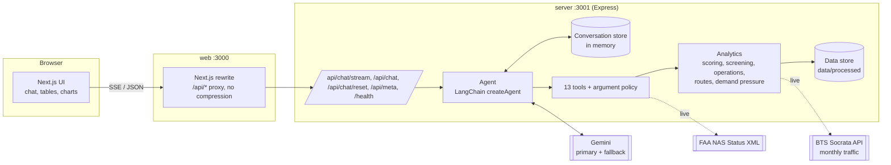
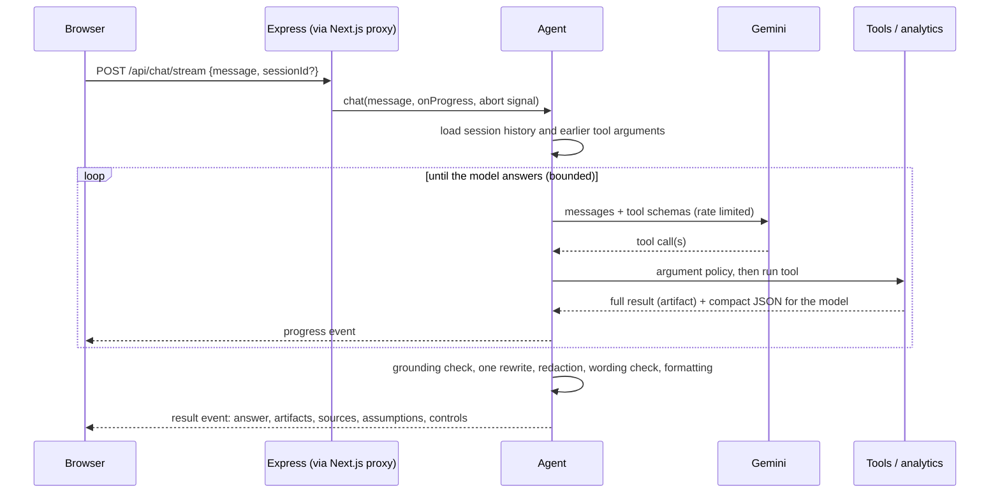

# Architecture and design

This document covers the scoring methodology, the key tradeoffs, and where and how AI is used. Setup and commands are in the [README](../README.md).

## 1. Where AI is used

| Done by code (deterministic) | Done by the model (Gemini) |
|---|---|
| Fetching and aggregating data | Choosing which tools to call, and with what arguments |
| Every number: traffic, rates, shares, ranks, scores | Writing the explanation in plain language |
| The opportunity score and its per-metric breakdown | Asking a clarifying question when a name is ambiguous |
| Comparisons and their "clear difference or not" verdicts | Interpreting informal wording ("LA", "the Southeast") |
| Argument checks and the figure check on the prose | |
| All tables and charts in the UI (rendered from tool output) | |

The model never sees the raw datasets. It receives compact tool results and is instructed to quote them rather than calculate. That instruction is not enforced, so the answer is checked afterwards (section 7), and the UI renders the full tool output directly instead of relying on the model's wording.

Gemini is an engineering choice (tool calling, LangChain integration, a free tier for development). The assignment does not require a specific model. Quotas vary by account and model.

## 2. Architecture

The browser talks only to the Next.js origin, which proxies `/api/*` to Express. The Gemini key exists only in the Express process.

Layers, each depending only on those below it:

- `server/src/data`: API clients, aggregation, loader for the committed data. No analytics.
- `server/src/analytics`: pure functions over data records. No HTTP, no model.
- `server/src/tools`: analytics wrapped as LangChain tools (Zod schemas, a uniform result envelope, the argument policy).
- `server/src/agent`: the model loop, conversation memory, safeguards. `compose.ts` wires the concrete dependencies.
- `server/src/app.ts`: HTTP and SSE only.
- `web/`: presentation. `services/api.ts` is the only backend caller; `hooks/useChat.ts` owns conversation state and streaming.

## 3. Request lifecycle

If the browser disconnects, an abort signal cancels the run so no quota is spent on an answer nobody reads. Every tool returns an envelope: `data`, `periods`, `sources`, `assumptions`, `limitations`, `warnings`, `controls`. The full result travels as the message artifact; the model sees a compact copy (decimals trimmed to four places, long explanations removed).

## 4. LangChain orchestration

- **Agent:** `createAgent` with Gemini at `temperature: 0`. The system prompt states scope, grounding rules and how to describe indicators.
- **Tools (13):** `resolve_airport`, `find_airports`, `screen_airports`, `rank_expansion_opportunities`, `get_traffic_metrics`, `compare_operations`, `get_route_network`, `search_routes`, `get_long_haul_share`, `get_airport_infrastructure`, `analyze_demand_pressure`, `get_current_faa_disruptions`, `get_methodology`. They are general queries (filter, sort, compare, rank) rather than one function per sample question, so other questions can be composed from them. Descriptions say what each tool does and does not measure. Schemas are flat because Gemini rejects some JSON Schema keywords.
- **Middleware:** model fallback, retry on transient errors only, a cap of 8 model calls and 12 tool calls per message, and a recursion limit. An identical repeated tool call in one message is refused with a short note.
- **Tool results are data.** The prompt treats FAA notices and user text as data, and the evaluation includes a prompt-injection scenario.

## 5. Scoring methodology

Implemented in `server/src/analytics/scoring.ts`; the definitions are also returned by `get_methodology` and shown in the About panel.

**Goal.** Shortlist airports where demand is large, growing and pressing on existing capacity, so added capacity is more likely to be used. It is a relative screening indicator, not a forecast, a profitability or ROI estimate, or an assessment of terminal capacity.

| Metric | Weight | Definition | Source |
|---|---|---|---|
| Passenger scale | 20 | Passengers, latest 12 months | BTS T-100 (API) |
| Passenger growth | 25 | Year-over-year change in 12-month passengers, shrunk (below) | BTS T-100 (API) |
| Seat load factor | 15 | Passengers / seats, 12-month sums | BTS T-100 (API) |
| Passenger vs seat growth gap | 15 | Shrunk passenger growth minus shrunk seat growth, in points | BTS T-100 (API) |
| Departures per commercial runway per day | 15 | 12-month departures (all service classes, including cargo and charter) / days / runways of at least 5,000 ft | BTS T-100 + FAA runways |
| Median taxi-out | 10 | Exact median from merged histograms, June to August 2026 | BTS On-Time (download) |
| Departures delayed 15+ min | 0 | Context only | BTS On-Time (download) |

Departure counts from the API include all-cargo and non-scheduled flights. They use runways but not passenger terminals, so at cargo hubs (Memphis, Anchorage) the runway metric overstates passenger-related pressure and seats per departure is understated. Passengers, seats and load factor are not affected. The weights are analyst judgement. No public data links these metrics to investment returns, and users can override them ("double the weight on growth"); the weights used are shown with each result.

**Computation**
1. Candidates are in-scope airports with at least 100,000 passengers in the latest 12 months (configurable).
2. Each metric becomes a percentile (0 to 100) within the candidates; ties share the average. Only rank order matters, so one outlier cannot dominate.
3. Growth is shrunk toward the candidate median: `g* = (n*g + k*median(g)) / (n + k)`, with `n` the prior-12-month passengers (seats for seat growth) and `k = 250,000`, so a few thousand extra passengers at a small airport is not read as a trend.
4. With at least 8 candidates, a metric whose percentiles correlate (Pearson) at 0.7 or more with another weighted metric has its weight divided by `1 + sum of those |correlations|`, so a shared signal is not counted twice. Configured and adjusted weights are both reported.
5. Score = sum of weight x percentile, with the adjusted weights normalised to sum to 100. Each airport returns every metric's contribution; they add up to the score.
6. A missing metric is never scored as zero. By default it receives the neutral 50th percentile, and the score bounds (missing metrics at the bottom or top) are reported. An airport needs at least 60% of the configured weight available to be scored. A `redistribute` policy is also implemented.
7. Rank sensitivity is reported: the range of ranks under equal weights, with each metric dropped in turn, and under the alternative missing-data policy.

**Comparisons** (`compare_operations`) are not scored. Rates are compared against a practical-difference floor (2 percentage points for 15-minute delays, 0.5 for cancellations), because flights on one day share weather and air-traffic conditions and a binomial test would overstate certainty. The verdict is "a higher", "b higher" or "indistinguishable". If on-time data covers under 50% of scheduled passenger departures, figures are flagged as indicative.

**Long haul.** Share of performed departures from the origin whose route distance is at least the threshold. Defaults: 3,000 miles, and service class F (scheduled passenger/cargo service) only. Also returned: sensitivity at other thresholds, distance bands, and the share under both class definitions (F only, and all classes F, G, L, P), each with its own total, because at cargo hubs the class choice changes the answer a lot (Anchorage, June to August 2026: about 4.6% for F against about 25% for all classes).

**Demand pressure (the SFO question).** The datasets used contain no bookings, fares, waitlists or denied-capacity data, so unmet demand cannot be measured. The tool instead compares indicators against a peer group of US airports with at least 5 million passengers (load factor, passenger vs seat growth, seats per departure, departures per runway, taxi-out, delays, cancellations, monthly load factor), each labelled with what it suggests and what it does not show. It does not explain "why".

## 6. Data: collection, caching, fallback

| Data | Access | Runtime behaviour |
|---|---|---|
| Monthly passengers, seats, departures | **Public API** (BTS Socrata) | Live, cached 6 h. If the call fails, the bundled snapshot is used and the result is labelled `snapshot-fallback`. |
| Current airport disruptions | **Public API** (FAA NAS Status XML) | Live, cached 60 s; current conditions only. |
| Runways, coordinates | **Public API** (FAA ArcGIS REST) | Fetched at build time into `airports.json`. |
| Routes, distances, service class | **Public download** (BTS T-100 Segment, TranStats form) | Aggregated at build time into `route-segments.csv.gz`. |
| Delays, cancellations, taxi-out | **Public download** (BTS On-Time Performance, TranStats form) | Aggregated at build time into `ontime-airport-month.json.gz`. |

The last two have no API; BTS publishes them through a download form at about 35 MB per month. A script downloads them once and aggregates them into files of a few hundred KB, which are committed. As a result, route and delay metrics cover only June to August 2026 until the data is rebuilt, and the app states this on affected results. Aggregates hold counts, sums and taxi-out histograms, never rates, so months combine exactly and medians can be computed. Build steps are `data:download`, `data:build` and `data:verify` (a coverage and consistency report for manual review). Raw archives are not kept.

Airport names are resolved by code, name or city. An ambiguous name returns options. When one airport carries at least 80% of the candidates' passengers and no same-named city in another state has 100,000+ passengers (Anchorage, Denver), it is used automatically and the choice is disclosed with alternatives.

## 7. Conversation, argument policy, and checks

**Conversation.** Sessions are kept in memory by UUID: up to 200, one-hour idle expiry, last 8 turns or 24,000 characters. Each turn stores the user text, the answer, a one-line digest per tool call, the numbers the user saw, and the arguments that actually ran. Follow-ups use that memory; the model is told to call tools again rather than trust digests. A second message in a busy session returns 409; beyond 4 concurrent messages, 429. "New chat" aborts any in-flight request and deletes the session.

**Argument policy** (`tools/argPolicy.ts`). Models tend to add filters the user did not ask for or drop a scope from earlier. Before a tool runs, code classifies narrowing arguments as explicit (the number or keyword is in the user's message or an earlier explicit value), derived (a relative change such as "double") or assumed. Assumed passenger floors, windows, thresholds, weights, cargo classes and filters are ignored and the tool default applies. Explicit settings carry into follow-ups unless the user says "reset" or "all US airports". Each action is shown as a notice. It is a wording heuristic and can misjudge intent.

**Model availability.**
- A per-model sliding-window limiter (12 requests per minute by default) wraps every model request, retries included. It limits request rate only; it does not track daily or token quotas, which Google enforces and which surface as errors.
- Retries use exponential backoff with jitter for rate-limit, overload and network errors. A daily-quota error is not retried; it moves to the fallback model (`gemini-3.1-flash-lite` by default).
- A 90 s deadline bounds each message. Failures return typed errors that the UI explains. If both models are down, a message can wait the full 90 s.

**Grounding.** These checks reduce invented figures; they do not eliminate them.
1. An answer with figures but no tool call is sent back once to call tools.
2. Numbers and years in the answer are matched against every number in the turn's tool results, the user's message and earlier turns, allowing rounding, truncation, percent conversion and K/M/B units.
3. Unmatched figures trigger one rewrite; if any remain, the sentences containing them are removed and the answer says so.
4. A wording guard flags strong comparatives ("significantly") not backed by a tool verdict, requests one softer rewrite, otherwise appends a note.
5. Raw decimals copied from results (0.2415) are formatted (24.1%) when they match a rate-like field.

The figure check only confirms that a number appears somewhere in the tool results. It cannot detect a correct number attached to the wrong airport, ignores whole numbers of 20 or less, and cannot verify wording, causes or conclusions. The wording guard knows a short list of phrases.

**Security.** The key is read only by the Express process, never sent to the browser, redacted from logged errors, and absent from the web container. Model text is rendered through a small Markdown renderer that builds React elements, not HTML strings. Request bodies are limited to 20 KB and messages to 2,000 characters.

## 8. SSE streaming

`POST /api/chat/stream` returns `text/event-stream` with `progress` events (`thinking`, `model_retry`, `tool_start`, `tool_done`, `checking`, `rewriting`), then one `result` or `error` event, plus a `: keep-alive` comment every 15 s. Headers are `cache-control: no-cache, no-transform` and `x-accel-buffering: no`; Next.js has compression off and a longer proxy timeout so events are not held back. The client parses the stream with `fetch` and tolerates events split across chunks. Errors before the stream starts are ordinary JSON responses. Incremental delivery through the Next.js proxy was checked with timestamps.

## 9. Tradeoffs

| Decision | Reason | Cost |
|---|---|---|
| Percentile scoring, judgemental weights | Transparent, robust to outliers, adjustable per question | Relative to the candidate set; weights are opinion |
| Neutral imputation for missing metrics | Missing data neither helps nor hurts on average; bounds reported | Less sharp than redistributing weights |
| Prefetched bulk BTS files | No API exists; per-question downloads are impractical | Route and delay metrics fixed to three months until rebuilt |
| Live API for traffic, labelled snapshot fallback | Fresh totals, honest when unavailable | One extra network call per question (cached 6 h) |
| Counts and histograms, not rates, in the data files | Exact combination across months, exact medians | Larger schema |
| General query tools, not one tool per question | Handles unanticipated questions | The model must fill arguments, hence the argument policy |
| Code-side argument and figure checks | Models add filters and mis-state numbers | Heuristic: can misjudge intent or miss a mis-attributed number |
| UI rendered from tool output | Displayed numbers do not depend on model wording | Prose and tables can still differ in wording |
| In-memory conversations | No database, simple to run | Lost on restart; single instance |
| Rate limiter inside the model wrapper | Retries cannot exceed the request cap | Simultaneous users queue behind 12 requests per minute |
| Next.js proxy | Same origin, no CORS, key and backend URL stay private | Proxy target fixed at build time in Docker |
| Gemini (free-tier key in development) | Low cost for a prototype, tool calling supported | Account- and model-specific quotas and availability set the reliability ceiling |

## 10. Assumptions and limitations

- Opportunity is measured by demand and capacity-pressure indicators. Profitability, revenue, costs, financing, regulation, competition, terminal size and gate capacity are not in the data used.
- Operations cover June to August 2026 (seasonally busy) and only BTS reporting carriers; coverage is shown per airport.
- "Long haul", the 5,000 ft runway cutoff, the 100,000-passenger floor, the shrinkage constant and the weights are assumptions, shown with results and adjustable.
- Informal places depend on the model's interpretation; the states used are listed and flagged, but may differ from what the user meant.
- Grounding, wording and argument checks are heuristics (section 7). Conversations are in memory and there is no authentication.

## 11. Testing and verification

- **Automated tests (399: 372 server, 27 web).** Analytics, data clients with mocked HTTP, tools and argument policy, the agent with a scripted fake model (retries, fallback, rate limiting, grounding, cancellation, SSE, HTTP contract), and the UI.
- **Live evaluation.** `npm run eval:agent` runs 20 scenarios against the real model and live data (the four assignment questions, follow-ups, ambiguity, unsupported requests, tool failure, weak data, prompt injection). Last run: 77 of 78 checks passed; the miss is the "Southeast" interpretation. Output: `docs/e2e/agent-eval.md`.
- **Docker.** Images build and start, health checks pass, and `/api/meta` and SSE events work through the web container. A complete Gemini answer inside Docker has not been observed because the provider quota was exhausted when it was attempted (see the README's verification status).
